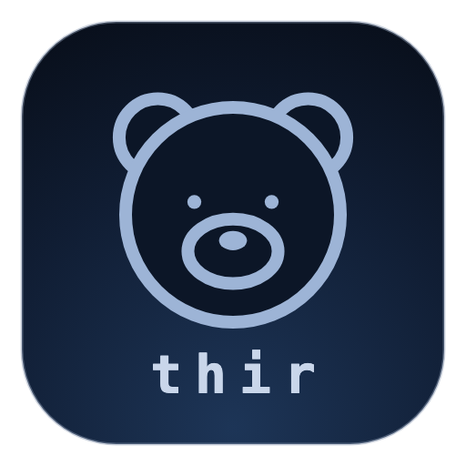
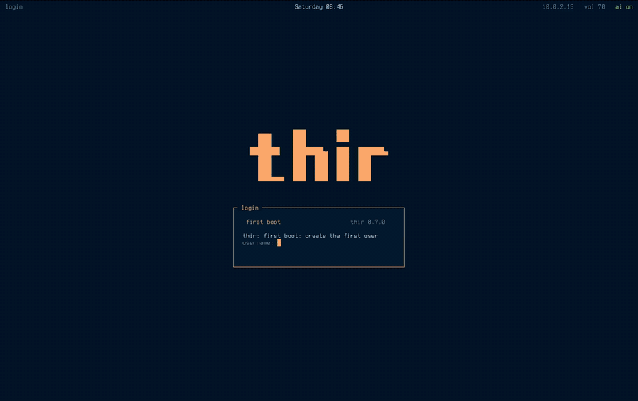
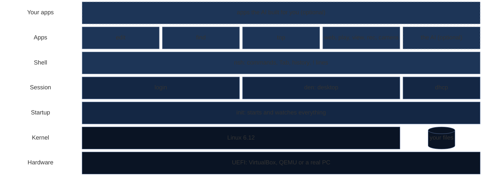

<p align="center"></p>

# thir

thir is a small operating system I wrote to learn how one works. It boots the Linux kernel, and everything after that is my own Rust code.

<p align="center"></p>

The GIF runs at double speed. [Watch the full video with sound](https://github.com/Adhishtanaka/thir/raw/master/docs/thir.mp4) (1 minute).

## What's in it

You get a desktop of panes that you split side by side, a shell, and a login. There are small apps for notes, a calendar, contacts, a clock and a calculator. A browser (YouTube plays) is included, plus a music and video player, a picture viewer, a voice recorder and a camera.

The AI is optional. Type `!` and say what you want, like `! move notes into docs` or `! make me a weather app`. thir shows you what it will do and waits for your yes. You bring your own key, or you pick "no AI" when you first log in.

## How it fits together



Read it from the bottom up. Each layer starts the one above it. The two boxes marked "optional" are the AI. thir works without them.

## Try it

Download a file from the [latest release](https://github.com/Adhishtanaka/thir/releases/latest):

| File | For |
|---|---|
| `thir-vbox-arm64.ova` | VirtualBox on an Apple Silicon Mac |
| `thir-vbox-x86_64.ova` | VirtualBox on Windows, Linux or an Intel Mac |
| `thir-arm64-uefi.img.xz` | UTM or QEMU on ARM |
| `thir-x86_64-uefi.img.xz` | a real PC, from a USB stick |

Give the VM 2 GB of memory and 2 CPUs. `INSTALL.txt` in the release has the USB steps. Be careful with `dd`, because it erases the disk you name without asking.

## Keys

| Keys | What they do |
|---|---|
| Option + Enter | new pane |
| Option + arrows | move between panes |
| Option + f / q | full screen / close a pane |
| Ctrl + Shift + C / V | copy / paste (Cmd + C / V works too) |

Type `help` to see the rest.

## Build it

You need a Mac with Docker and QEMU (`brew install qemu`).

```
./build.sh                # the first build compiles WebKit and takes hours
./run.sh gui
THIR_SMALL=1 ./build.sh   # tiny version without the browser and media apps
```

## License

My code is MIT ([LICENSE](LICENSE)). The Linux kernel is GPL-2.0 ([source](https://cdn.kernel.org/pub/linux/kernel/v6.x/linux-6.12.117.tar.xz)). WebKit, GStreamer, glib, libsoup, GnuTLS and ffmpeg are LGPL. The release notes list the source links.
