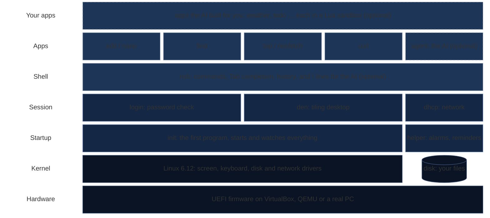

<p align="center"></p>

# thir

thir is a tiny operating system I built for fun and to learn how one works from the inside. It uses the Linux kernel, and everything on top of it is my own code, written in Rust, apart from a few well-known libraries for things like password hashing and encryption. That covers the startup program, the shell, the login, the desktop and the small apps.

The whole system is about 11 MB and boots in a couple of seconds.


Full video: [docs/demo.mp4](docs/demo.mp4) (about 1 minute, recorded in VirtualBox on a Mac).

## What you get

- A login with your own user and password. Passwords are stored as a slow, salted hash, never as plain text.
- A desktop of terminal panes that you can split side by side, with a blue wallpaper and a small bear.
- Your files are saved on a disk and are still there after a restart.
- A shell with Tab completion, history (Up and Down arrows) and grey suggestions from your history.
- A few apps: `edit` (a simple editor, also called `nano`), `find`, `top` (CPU and memory use) and `neofetch`.
- `curl`, for downloading web pages and files over HTTP and HTTPS.
- (optional) An AI shell: type `!` and your words, like `! move notes into docs` or `! make me a timer app`. The AI turns them into one command or action, thir shows it, and nothing runs until you press Enter (yes). Anything that deletes or powers off defaults to no. Lines without `!` are a normal shell.
- (optional) The AI also works the apps: `! add Kasun to my contacts, 0771234567", `! what is on my calendar tomorrow`, `! set an alarm for 6:30`, `! add buy milk to my notes as a todo`. thir shows what it will do and asks first. When a question needs your contacts, notes or calendar, only the matching records go to the AI, and thir says how many.
- Reminders, shown in the top bar of the desktop.
- (optional) AI setup at the first login. You pick a provider and add your own key, or choose "no AI". You can change it later in settings.
- (optional) Self-healing apps: if an app the AI built breaks, thir sends the error back and the AI fixes it.
- Built-in apps with sound: `clock` (alarms that ring even when it is closed, stopwatch, timer), `calendar` (events and reminders), `calc`, `contacts`, `notes` (with todo boxes), `settings` (time zone, wallpaper, sound) and `help`, a guide to everything.

## How it works

When you turn it on, the computer's firmware loads the Linux kernel. The kernel starts `init`, my first program, and from there everything is thir's own Rust code.



Read it from the bottom up: each layer starts the one above it. The lighter boxes (your shell and apps) run as you, so they can only touch your own files. The dashed boxes are the AI, which is optional. The apps the AI builds sit on top and get even less: no files at all, only the websites you allowed. The darker boxes run the system.

## The AI (optional)

At the first login thir asks which AI to use. Choose `0` (no AI) to use thir without it. You can turn it on or off later in `settings`. With the AI off, a `!` line only says so, and nothing goes to any provider. Reminders and alarms still work. Turning it off keeps your saved keys until you remove them. Everything below works only when it is on. A video of the AI at work: [docs/demo-ai.mp4](docs/demo-ai.mp4) (the [GIF](docs/demo-ai.gif) is shorter).

This is the bit I'm most curious about. Normally you go find an app that does roughly what you want. In thir you just say it: `! make me a weather app`, and an AI model writes a small app for you on the spot. It plans the app, writes it in Lua, and thir checks the code and test-runs it offline before you ever see it. If the test fails, the model gets the error and tries again.

Type `!` and your words for everything else. `! what is using my disk?` gets an answer, and thir tells the AI about your system so it knows what is installed. `! download this page as page.html` or `! move notes into docs` become one normal command, like `curl -o page.html URL`, shown exactly as it will run. You press Enter to run it. The AI cannot use pipes, `;`, `&&` or backticks, and commands that delete or power off ask with a warning and default to no. `! remind me at 5pm to call mum` sets a reminder that shows in the top bar. `! what do you remember about me` shows what thir keeps, like your city, so the weather app opens on it. `! change my AI provider` changes your provider or key. Type `!` alone for examples.

The model never gets real power. Apps run in a sandbox with no access to your files or keys, and they only reach the websites you said yes to. You bring your own API key (Anthropic, OpenAI, Gemini, DeepSeek, or a local Ollama). It's still rough: small models sometimes need a retry, and a two-minute wait for an app is long. But watching a computer write itself a tool you asked for is pretty fun.

## Try it

Download the files from the [latest release](https://github.com/Adhishtanaka/thir/releases/latest).

**VirtualBox on an Apple Silicon Mac (easiest).** Get `thir-vbox-arm64.ova`, open VirtualBox, choose File > Import Appliance, then press Start. On the first boot, thir asks you to make a user name and a password.

**VirtualBox on Windows, Linux or an Intel Mac.** Get `thir-vbox-x86_64.ova` and import it the same way (File > Import Appliance), then press Start. The appliance is already set to use EFI firmware, so you do not need to change any settings.

**A real PC from a USB stick.** Get `thir-x86_64-uefi.img.xz` and write it to a USB stick:

```
diskutil list                      # find the USB stick, e.g. /dev/disk4
diskutil unmountDisk /dev/diskN
xzcat thir-x86_64-uefi.img.xz | sudo dd of=/dev/rdiskN bs=4m
diskutil eject /dev/diskN
```

Be careful here. `dd` erases the whole disk you give it and does not ask first. If you type the wrong number, you can wipe your own Mac. Check `diskutil list` twice.

Then, on the PC, turn off Secure Boot in the firmware settings, open the boot menu (usually F12, F8, Esc or Del) and pick the USB stick. thir does not touch the PC's own disks. Wired network works on most PCs. Wi-Fi does not work yet.

**UTM or QEMU on ARM.** Use `thir-arm64-uefi.img.xz` as a UEFI disk.

## Using it

| Keys | What they do |
|---|---|
| Option + Enter (or Cmd + Enter) | Split the screen into a new pane |
| Option + arrow keys | Move between panes |
| Option + q | Close a pane |
| Option + f | Make a pane full screen |

Some commands to start with: `help`, `ls`, `mkdir notes`, `edit notes/todo.txt`, `find . -name '*.txt'`, `top`, `neofetch`, `date`. Type `help` to see them all.

## Build it yourself

You need a Mac with Docker and QEMU (`brew install qemu`).

```
./build.sh          # build everything (the AI is part of it; turn it off at first login)
./run.sh gui        # start it in a window
```

## License

thir's own code is under the [MIT License](LICENSE). The Linux kernel inside the images is GPL-2.0 (unmodified 6.12.117, [source](https://cdn.kernel.org/pub/linux/kernel/v6.x/linux-6.12.117.tar.xz)), and the Terminus font is under the SIL Open Font License. rustls and ring (Apache-2.0/MIT/ISC) encrypt web connections; root certificates from webpki-roots (CDLA-Permissive-2.0). Lua 5.4 (MIT) is included too.
