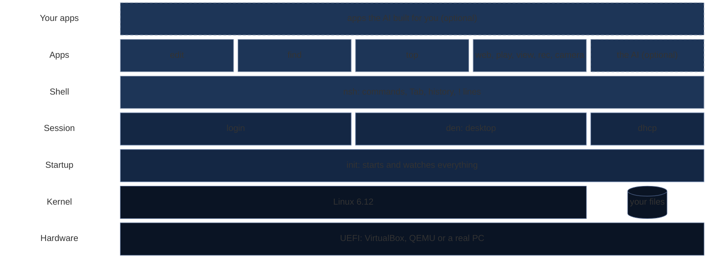

<p align="center"></p>

# thir

thir is a small operating system I wrote to learn how one works. It runs on the Linux kernel, and the rest is my own Rust code.

<!-- video -->

## What you get

A desktop of terminal panes you can split side by side, with a login, a shell and your files kept on disk. There are small apps for notes, a calendar, contacts, a clock with alarms, and a calculator. A browser, a music and video player (YouTube plays in the browser), a picture viewer, a voice recorder and a camera app are included too. Settings changes the wallpaper (navy, graphite, forest, plum, ember) and the accent colour (peach, blue, mint, lilac, rose); every combination keeps text readable (WCAG AA). Settings can also set your own picture as the wallpaper (`settings wallpaper FILE`) and an accent colour by hex code (`settings accent #rrggbb`).

If you want, you can add an AI. Type `!` and say what you want: `! move notes into docs`, `! make me a weather app`. thir shows the command and waits for Enter. You bring your own key, or pick "no AI" at first login. If the AI asks you a question, a dim `↳` prompt takes your answer and the talk goes on; Enter on an empty line leaves it, a new `!` line within 10 minutes continues the talk, and `!!` starts a fresh one. Every action still asks first.

## How it fits together



Read it from the bottom up. Each layer starts the one above it. The two boxes marked "optional" are the AI. thir works without them.

## Try it

Get a file from the [latest release](https://github.com/Adhishtanaka/thir/releases/latest).

- VirtualBox on an Apple Silicon Mac: `thir-vbox-arm64.ova`. Import it and press Start.
- VirtualBox on Windows, Linux or an Intel Mac: `thir-vbox-x86_64.ova`. Same steps.
- UTM or QEMU on ARM: `thir-arm64-uefi.img.xz`, as a UEFI disk.
- A real PC from a USB stick: `thir-x86_64-uefi.img.xz`.

Give the VM 2048 MB of memory and 2 CPUs. Turn on the USB tablet, and audio in and out.

A webcam works too. In VirtualBox, plug it in, then choose Devices, Webcams, and pick it (this needs the VirtualBox Extension Pack; or add a USB filter for it). Run `camera` in a pane: thir asks in the top bar first, then shows the picture. Space takes a photo into `~/Pictures`. It takes photos only, no video. If the VM has no webcam, `camera` says so and stops.

For the USB stick, on a Mac:

```
diskutil list                      # find the stick, e.g. /dev/disk4
diskutil unmountDisk /dev/diskN
xzcat thir-x86_64-uefi.img.xz | sudo dd of=/dev/rdiskN bs=4m
diskutil eject /dev/diskN
```

`dd` erases whatever disk you name, and it doesn't ask. Check `diskutil list` twice. Then turn off Secure Boot on the PC and pick the stick in the boot menu. thir leaves the PC's own disks alone. Wired network works on most PCs, Wi-Fi doesn't work yet.

## Keys

| Keys | What they do |
|---|---|
| Option + Enter (or Cmd + Enter) | split into a new pane |
| Option + arrows | move between panes |
| Option + q | close a pane |
| Option + f | full screen for a pane |
| Drag, double-click, triple-click | select text, a word, or a line |
| Ctrl + Shift + C / V (or Cmd + C / V) | copy and paste; the browser shares the clipboard |

Type `help` to see every command. In the browser, Ctrl-L is the address, Ctrl-T and Ctrl-W open and close tabs, Ctrl-F finds, Ctrl-R reloads, Ctrl-J lists downloads (p pauses or resumes, c cancels), Ctrl-H lists history (type to search, Enter opens, Delete removes one, Ctrl-K clears), Ctrl-Q quits (the tab keys also work while the address line is open). In the address line, find line and prompts: Ctrl-A selects all, Ctrl-C, Ctrl-X and Ctrl-V copy, cut and paste (one clipboard shared with the page). Pages play video and sound.

## Build it yourself

You need a Mac with Docker and QEMU (`brew install qemu`).

```
./build.sh          # the full thir; the first build compiles WebKit and takes hours
./run.sh gui        # start it in a window
THIR_SMALL=1 ./build.sh   # a tiny version, no browser or media apps
```

## License

My code is MIT ([LICENSE](LICENSE)). The Linux kernel inside is GPL-2.0, unmodified 6.12.117 ([source](https://cdn.kernel.org/pub/linux/kernel/v6.x/linux-6.12.117.tar.xz)). The browser and media apps bring WPE WebKit ([source](https://wpewebkit.org/releases/)), glib, libsoup and GnuTLS ([source](https://download.gnome.org/sources/)), and ffmpeg ([source](https://ffmpeg.org/releases/)), all LGPL. Mesa is MIT, the Noto and Droid fonts are OFL and Apache, and Terminus is OFL. rustls, ring and Lua are permissive too.
