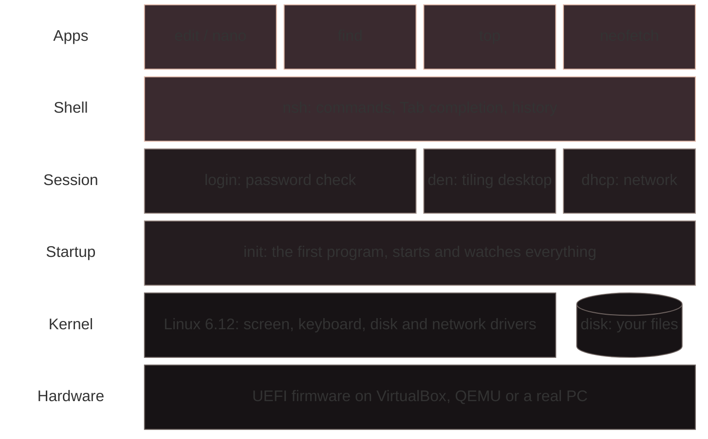

<p align="center"></p>

# thir

thir is a tiny operating system I built for fun and to learn how one works from the inside. It uses the Linux kernel, and everything on top of it is my own code, written in Rust: the startup program, the shell, the login, the desktop and the small apps.

The whole system is under 10 MB and boots in a couple of seconds.


Full video: [docs/demo.mp4](docs/demo.mp4) (about 2 minutes, recorded in VirtualBox on a Mac).

## What you get

- A login with your own user and password. Passwords are stored as a slow, salted hash, never as plain text.
- A desktop of terminal panes that you can split side by side, with a small bear wallpaper.
- Your files are saved on a disk and are still there after a restart.
- A shell with Tab completion and history (Up and Down arrows).
- A few apps: `edit` (a simple editor, also called `nano`), `find`, `top` (CPU and memory use) and `neofetch`.

## How it works

When you turn it on, the computer's firmware loads the Linux kernel. The kernel starts `init`, my first program, and from there everything is thir's own Rust code.



Read it from the bottom up: each layer starts the one above it. The lighter boxes (your shell and apps) run as you, so they can only touch your own files. The darker boxes run the system.

## Try it

Download the files from the [latest release](https://github.com/Adhishtanaka/thir/releases/latest).

**VirtualBox on an Apple Silicon Mac (easiest).** Get `thir-vbox-arm64.ova`, open VirtualBox, choose File > Import Appliance, then press Start. On the first boot, thir asks you to make a user name and a password.

**VirtualBox on Windows, Linux or an Intel Mac.** Get `thir-vbox-x86_64.ova` and import it the same way (File > Import Appliance), then press Start. The appliance is already set to use EFI firmware, so you do not need to change any settings.

**A real PC from a USB stick.** Get `thir-x86_64-uefi.img.xz` and write it to a USB stick:

```
diskutil list                      # find the USB stick, e.g. /dev/disk4
diskutil unmountDisk /dev/diskN
xzcat thir-x86_64-uefi.img.xz | sudo dd of=/dev/rdiskN bs=4m
diskutil eject /dev/diskN
```

Be careful here. `dd` erases the whole disk you give it and does not ask first. If you type the wrong number, you can wipe your own Mac. Check `diskutil list` twice.

Then, on the PC, turn off Secure Boot in the firmware settings, open the boot menu (usually F12, F8, Esc or Del) and pick the USB stick. thir does not touch the PC's own disks. Wired network works on most PCs. Wi-Fi does not work yet.

**UTM or QEMU on ARM.** Use `thir-arm64-uefi.img.xz` as a UEFI disk.

## Using it

| Keys | What they do |
|---|---|
| Option + Enter (or Cmd + Enter) | Split the screen into a new pane |
| Option + arrow keys | Move between panes |
| Option + q | Close a pane |
| Option + f | Make a pane full screen |

Some commands to start with: `help`, `ls`, `mkdir notes`, `edit notes/todo.txt`, `find . -name '*.txt'`, `top`, `neofetch`, `date`. Type `help` to see them all.

## Build it yourself

You need a Mac with Docker and QEMU (`brew install qemu`).

```
./build.sh          # build everything
./run.sh gui        # start it in a window
```

## License

thir's own code is under the [MIT License](LICENSE). The Linux kernel inside the images is GPL-2.0 (unmodified 6.12.117, [source](https://cdn.kernel.org/pub/linux/kernel/v6.x/linux-6.12.117.tar.xz)), and the Terminus font is under the SIL Open Font License.
