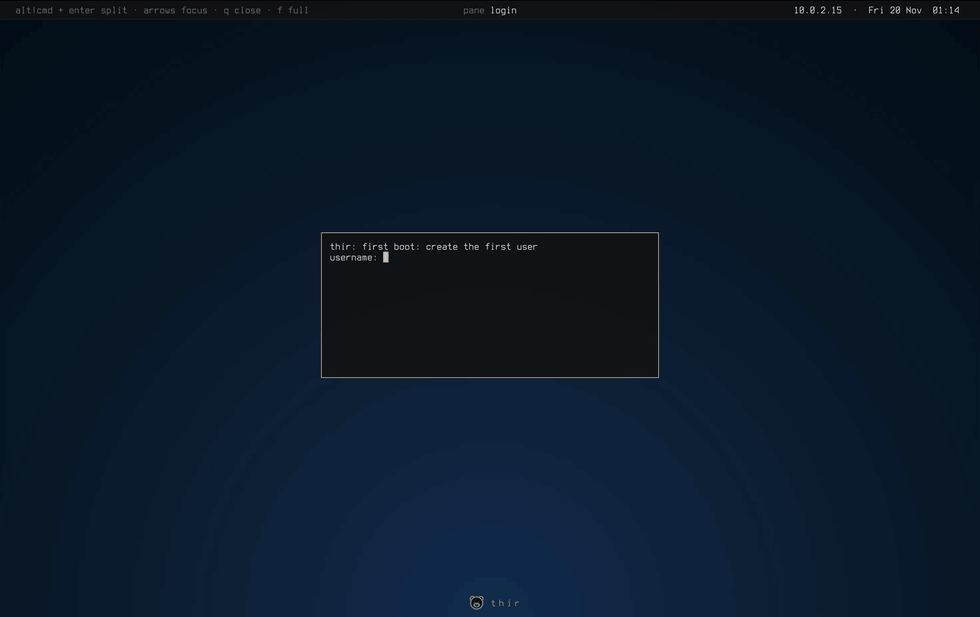
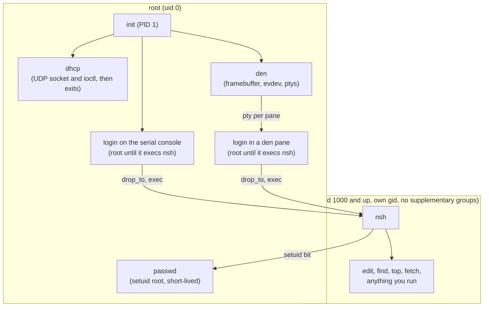
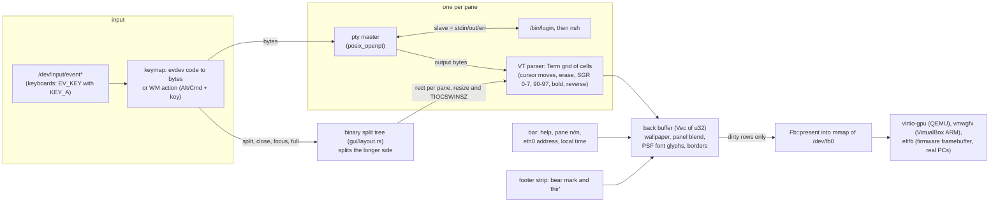
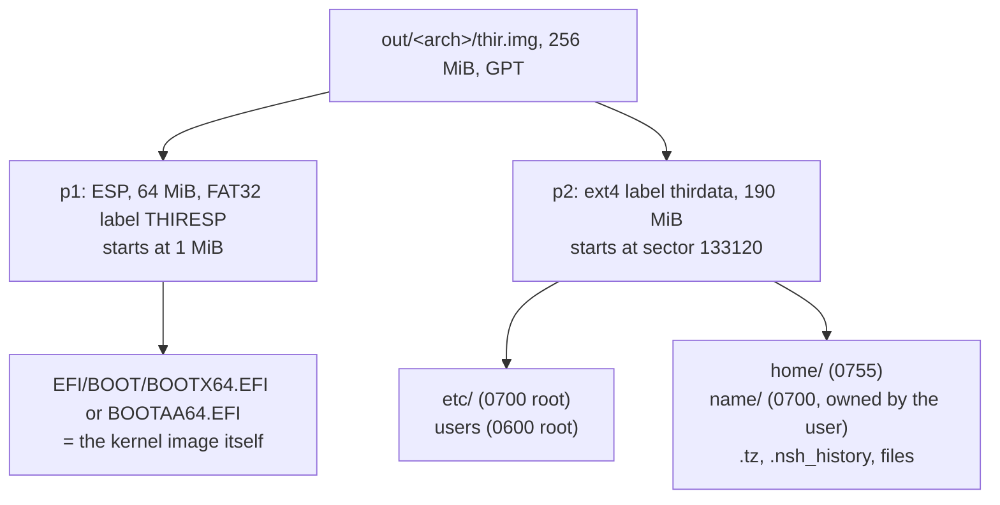
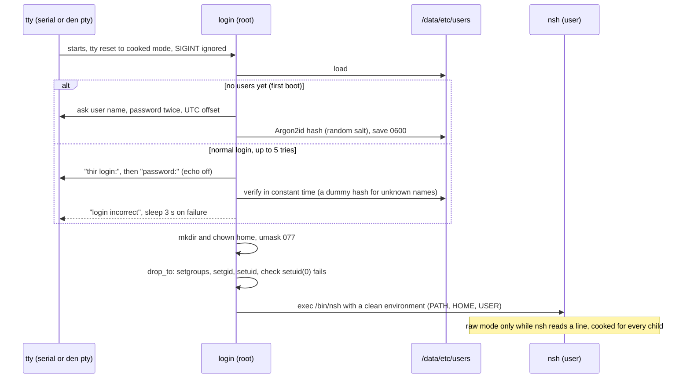
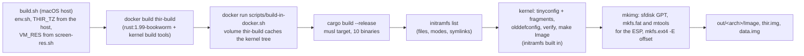

# thir: technical reference

The full technical notes: architecture, build, tests, security and every command. For a short introduction, see the [README](../README.md).


A tiny research OS for network work: the Linux kernel (6.12, a `tinyconfig` build with everything compiled in) plus a userspace written only in Rust.
No distro, no systemd, no busybox. One kernel image holds the whole userspace as a built-in initramfs; one small ext4 volume holds the accounts and home directories.
Userspace: a PID 1 (`init`), a shell with a line editor (`nsh`), a DHCP client, `login`/`passwd` with Argon2id, `den` (a tiling terminal GUI drawn straight on the framebuffer),
an editor (`edit`, also `nano`), `find`, `top` and `fetch` (also `neofetch`). It boots in QEMU (aarch64 with HVF, or x86_64 emulated), in VirtualBox on Apple Silicon, and from a USB stick on a UEFI PC.



Same recording as video: [docs/demo.mp4](demo.mp4) (115 s, 2936x1848, H.264). Recorded in VirtualBox full screen on an Apple Silicon Mac, from an empty disk by `scripts/vm-demo.sh` (keys sent with `VBoxManage controlvm keyboardputstring`, macOS `screencapture -v`).

Step 1: a Rust PID 1 (`init`), a small Rust shell (`nsh`) and a Rust DHCP client (`dhcp`).
Step 2: `den`, a tiling terminal GUI on the framebuffer. Phase 3: a persistent disk, accounts, login and file commands. Phase 4: HiDPI den, Cmd/Option as WM key, a brand footer, a line editor in `nsh`. Phase 5: a UEFI-bootable disk image (`out/<arch>/thir.img`) for a USB stick. Later: `fetch`, the demo recording.

## Prerequisites

- `brew install qemu`
- A Docker engine (Docker Desktop, Kiri, ...). More CPUs = faster kernel build.

## Commands

| Command | What it does |
|---|---|
| `./build.sh` | Builds Rust binaries + kernel (initramfs built in) + the UEFI disk image in Docker → `out/` |
| `./build.sh data` | Recreates `out/<arch>/data.img` (128 MiB, ext4). **Erases all user data and accounts** |
| `./build.sh test` | Runs `cargo test` in Docker (does not compile on macOS) |
| `./run.sh` | Boots in QEMU on this terminal. Ctrl-A X quits |
| `./run.sh gui` | Boots den full screen in QEMU (1 guest pixel = 1 Retina pixel); serial shell stays on this terminal. `GUI_RES=WxH` overrides the size (default: asked from macOS), `GUI_FULL=0` uses a window |
| `./test/smoke.sh` | Headless two-boot test on a fresh disk (first-boot setup, files, passwd, persistence), exit 0 = PASS |
| `./test/uefi.sh` | Boots `thir.img` on edk2 firmware (x86_64: a USB stick on xHCI; aarch64: virtio-blk), two boots, checks `/data` and persistence |
| `DEMO_PW=... scripts/vm-demo.sh out.mov` | Records the VirtualBox window (VM `thir` on first boot, window in front; needs Screen Recording permission for the terminal) |
| `DEMO_PW=... ./test/demo.sh` | Records `docs/demo.mp4`, `docs/demo.gif` and still screenshots (`docs/screenshots/`, not in git) headless (aarch64, 2560x1600, first user `thir`); refuses to run without `DEMO_PW`, which is never stored |
| `./test/gui.sh [out.png]` | Headless GUI test: logs in and types via the QEMU monitor on its own fresh disk, screendumps, checks the picture (aarch64) |
| `docker volume rm thir-build` | Clean kernel tree and caches |

## Architecture

Everything runs from RAM except `/data`. The kernel image is the only file the firmware loads: it is an EFI program (EFI stub) with a gzip cpio initramfs linked in.
Userspace is 10 static musl binaries (Rust, `opt-level = "s"`, LTO, `panic = "abort"`, stripped) plus two fonts. Nothing is dynamically linked, there is no libc on the image, and there are no kernel modules.

### Boot flow

```mermaid
flowchart LR
  FW["UEFI firmware<br/>(edk2 or the PC's)"] -->|"loads EFI/BOOT/BOOT*.EFI<br/>from the ESP"| STUB["Linux EFI stub<br/>(the kernel is the EFI app)"]
  STUB --> KERN["kernel start<br/>drivers built in"]
  KERN -->|"unpacks the built-in<br/>initramfs into rootfs"| INIT["/init, PID 1"]
  INIT --> MNT["mount devtmpfs, devpts, proc,<br/>sysfs, tmpfs /tmp and /run"]
  MNT --> SYS["fs.protected_hardlinks, symlinks,<br/>fifos, regular = 1"]
  SYS --> DATA["scan /sys/class/block for the ext4<br/>label thirdata, mount /data<br/>nosuid,nodev,noexec (retry 15 s)"]
  DATA --> NET["hostname thir, lo up,<br/>print interfaces"]
  NET --> DHCP["spawn /bin/dhcp"]
  DHCP --> READY["print 'thir: init ready'"]
  READY --> LOGIN["supervise /bin/login<br/>on the serial console"]
  READY --> DEN["supervise /bin/den<br/>if /dev/fb0 shows up (5 s)"]
```



QEMU `-kernel` (used by `run.sh` and the smoke and GUI tests) skips the first two boxes. init is a loop around `waitpid(-1)`: it restarts the console session or den when they exit (never sooner than 1 s apart),
acts on exit code 120 (power off) and 121 (reboot) after `sync` and an unmount, and reaps everything else (dhcp, orphans). It installs no signal handlers.

### Processes and privilege boundaries



The only privilege changes are `login` (root to user, irreversible: `setgroups`, `setgid`, `setuid`, all checked, and a test that `setuid(0)` fails afterwards) and the setuid-root `passwd`
(trusts only the real uid and the tty, ignores argv and environment). `/data` is `noexec`, so nothing a user writes can run from disk. den runs as root because it opens `/dev/fb0` and `/dev/input/event*`;
it executes only `/bin/login`, never echoes or logs keys, and reads the user-owned `~/.tz` defensively (see Time zone).

### den internals



den is one thread and one `poll(2)` over the input fds and the pty masters, with a 1 s timeout that also drives the bar clock and the rescan of input devices. Only panes whose `Term` is dirty are redrawn, and only the touched rows are copied to the framebuffer.
It needs a 32 bpp framebuffer in any channel order (it converts when the layout is not XRGB). At 2000 px or wider it uses the 16x32 font and doubles all metrics.

### Disk image layout



`out/<arch>/data.img` is the same `thirdata` volume as a bare 128 MiB ext4 file, used with `-kernel` boots (it appears as `vda`). init finds the volume by label, so `vda`, `vda2` and `sda2` (USB) all work.
`users` has one line per user: `name:uid:argon2id:m:t:p:salt:hash`.

### Login and authentication



Argon2id parameters: m=19456 KiB, t=2, p=1, 32-byte output, 16-byte random salt from `getrandom` (virtio-rng on the VM). Parameters are stored per user, so they can change later. Extra den panes run `login --as <uid>`, which only runs the drop and the exec.

### Components

Sizes are the stripped aarch64 release binaries from the current build (x86_64 is about the same).

| Binary | Runs as | Source | Role | Size |
|---|---|---|---|---|
| `init` | root, PID 1 | `src/bin/init.rs`, `src/disk.rs`, `src/net.rs`, `src/lib.rs` | mounts, finds and mounts `/data`, supervises login and den, power off and reboot | 452 KiB |
| `login` | root, then the user via `nsh` | `src/bin/login.rs`, `src/user.rs`, `src/clock.rs` | first-boot setup, authentication, privilege drop, exec `nsh` | 452 KiB |
| `nsh` | user | `src/bin/nsh.rs`, `src/line.rs`, `src/parse.rs`, `src/files.rs`, `src/glob.rs` | shell: line editor, history, completion, file builtins, redirection, `help` | 452 KiB |
| `den` | root | `src/bin/den.rs`, `src/gui/*` | tiling GUI on `/dev/fb0` | 452 KiB |
| `dhcp` | root | `src/bin/dhcp.rs`, `src/dhcp.rs`, `src/net.rs` | DHCPv4 client: address, mask, route, `/etc/resolv.conf` | 388 KiB |
| `passwd` | setuid root | `src/bin/passwd.rs`, `src/user.rs` | change your own password | 388 KiB |
| `edit` (`nano`) | user | `src/bin/edit.rs`, `src/edit.rs`, `src/term.rs` | full-screen editor | 388 KiB |
| `find` | user | `src/bin/find.rs`, `src/glob.rs` | find files by name and type | 388 KiB |
| `top` | user | `src/bin/top.rs`, `src/procinfo.rs`, `src/term.rs` | CPU, memory, processes from `/proc` | 452 KiB |
| `fetch` (`neofetch`) | user | `src/bin/fetch.rs`, `src/fetch.rs`, `src/procinfo.rs`, `src/net.rs` | bear logo and system facts (reads `/proc`, `/sys`, `uname`, `statvfs`) | 388 KiB |

The pure parts (parsers, formatters, the editor buffer, the VT grid, the layout tree) live in the library crate `thir` and are unit-tested without a VM; the binaries are thin I/O around them.
The only crates besides `libc` are `argon2` and `subtle` (see Security).

### Kernel configuration

`tinyconfig` is the base, so every feature is opt-in. `kernel/common.config` (49 lines) adds what both architectures need: ELF, devtmpfs, procfs/sysfs, UNIX98 ptys, TCP/IP, PCI, virtio (net, blk, rng, input, GPU), DRM with fbdev emulation, evdev, ext4, GPT, RTC, gzip initramfs and the EFI framebuffer.
`kernel/aarch64.config` (28 lines) adds PL011, PL031 RTC, ACPI, the VirtualBox pieces (virtio-SCSI, xHCI USB HID, EFI RTC, `vmwgfx`) and a built-in command line with `video=Virtual-1:WxH`.
`kernel/x86_64.config` (33 lines) adds 8250 serial, i8042 keyboard, CMOS RTC, xHCI/EHCI USB storage and the e1000e, igc and r8169 NICs.
The fragments are appended to `.config`, then `olddefconfig` runs, then a verification loop checks that every `CONFIG_X=y` line survived and every `# CONFIG_X is not set` line stayed off. A requested option that a missing dependency silently dropped fails the build, so the config cannot drift.
The initramfs file list is generated by `scripts/build-in-docker.sh` and referenced by `CONFIG_INITRAMFS_SOURCE`, so the kernel build embeds the binaries (the symlinks `/bin/nano` and `/bin/neofetch` are cpio entries).

### Build pipeline



The container is always native arm64; x86_64 is cross-built there (`gcc-x86-64-linux-gnu`) and run emulated by QEMU TCG. The images are built from plain files (no loop devices in Docker). The data image is created only when missing, so a build never erases accounts.

### Tests

| Suite | Command | What it covers | Runs on |
|---|---|---|---|
| unit | `./build.sh test` | 111 `cargo test` tests: parsers, line editor, VT grid, layout, Argon2 records, clock, fetch formatting, help table | Docker (arm64) |
| smoke | `./test/smoke.sh` | two serial boots on a fresh disk: first-boot setup, file commands, permission denials, `edit`, `neofetch`, `top`, `passwd` delay, persistence, old password rejected; the serial log must never contain a password | QEMU, either arch |
| uefi | `./test/uefi.sh` | boots `thir.img` on edk2 (no `-kernel`), setup, a file on `/data`, second boot | QEMU, either arch |
| gui | `./test/gui.sh` | den at 2560x1664: types through the QEMU monitor, login, split, Tab completion, screendump checks (size, colours, footer mark), logout | QEMU aarch64 |
| demo | `DEMO_PW=... ./test/demo.sh` | records `docs/demo.mp4`, `docs/demo.gif` and still screenshots (not in git); refuses to run without `DEMO_PW` | QEMU aarch64 |

## Layout

```
env.sh                     THIR_ARCH + all derived settings (sourced by every script)
build.sh, run.sh           host scripts
test/smoke.sh              boot test
test/uefi.sh               UEFI boot test of thir.img
test/lib.sh                shared test helpers
out/<arch>/thir.img        GPT image: ESP (EFI/BOOT/BOOT{X64,AA64}.EFI = the kernel) + ext4 `thirdata`; regenerated by every build
src/disk.rs                ext4 superblock label parser
docker/Dockerfile          build image
scripts/build-in-docker.sh cargo, initramfs list, kernel config/verify/build, GPT image
kernel/*.config            kernel fragments applied on top of tinyconfig
src/lib.rs                 exit-code protocol (decide)
src/parse.rs               shell line parser (quotes, > and >>)
src/user.rs                accounts: Argon2id hashes, /data/etc/users, privilege drop
src/files.rs               rm safety check, printable/unsafe_char (hostile names)
src/clock.rs               date math, UTC offsets, ~/.tz reader (pure)
src/term.rs                raw-mode guard, size, key reading, prompt (edit and top)
src/edit.rs                editor buffer + renderer (pure)
src/glob.rs                `*` `?` matcher for find
src/procinfo.rs            /proc parsers for top
src/line.rs                nsh line editor (keys, history, completion; pure)
src/net.rs                 interfaces, address, route (ioctl)
src/dhcp.rs                DHCP packet build/parse
src/bin/dhcp.rs            DHCP client
src/bin/init.rs            PID 1
src/bin/nsh.rs             shell
src/bin/login.rs           login (serial and den panes), first-boot setup
src/bin/passwd.rs          change your own password (setuid root)
src/bin/edit.rs            full-screen editor (`/bin/nano` is a link to it)
src/bin/find.rs            find
src/bin/top.rs             CPU, memory, process monitor
src/bin/fetch.rs           system summary with a bear (`/bin/neofetch` is a link to it)
src/fetch.rs               fetch's logo, parsers and formatting (pure)
test/demo.sh               records the demo video, GIF and screenshots
assets/logo*               project logo (logo.html is the source)
out/<arch>/data.img        raw ext4 data disk, created when missing, never reformatted by a build
src/bin/den.rs             GUI event loop
src/gui/                   fb, wall (code-drawn wallpaper + bear), font (PSF), vt (terminal), layout (split tree), keymap, theme (all colors)
assets/                    wallpaper.png, fonts/ (Terminus PSF 16 and 32x16 + OFL license; wallpaper.html is the design source of the code-drawn wallpaper)
test/gui.sh                GUI test
```

## How boot works

firmware (or QEMU `-kernel`) → kernel (the initramfs is built into it) → `/init` → mount `/dev /proc /sys /tmp /run` → hostname `thir` → `lo` up → print interfaces →
mount `/data` (the ext4 volume labelled `thirdata`, found by scanning `/sys/class/block` and reading the superblock; retried for 15 s because USB is slow) → `thir: init ready` → start `/bin/login` on the serial console and restart it when it exits.
init blocks in `waitpid(-1)` and dispatches on the pid (console session, den, or any other child that is just reaped).
`nsh` asks init to power off with exit code 120 and to reboot with 121. PID 1 has no signal handlers.

## Booting a real PC from a USB stick (x86_64)

The kernel is its own EFI program (EFI stub, no bootloader): `EFI/BOOT/BOOTX64.EFI` on the stick's FAT32 partition.

1. `THIR_ARCH=x86_64 ./build.sh` gives `out/x86_64/thir.img`.
2. **Warning: `dd` overwrites the whole target disk without asking. A wrong disk number destroys your Mac's data or another drive. Check `diskutil list` twice: the stick is `(external, physical)` with the stick's size.**
   ```
   diskutil list
   diskutil unmountDisk /dev/diskN
   sudo dd if=out/x86_64/thir.img of=/dev/rdiskN bs=4m
   diskutil eject /dev/diskN
   ```
   macOS may say the disk is not readable (ext4): choose Ignore/Eject. Writing the image again erases the accounts and files on the stick.
3. On the PC: **disable Secure Boot** (the kernel is unsigned) → boot menu (F12/F8/Esc/Del) → `UEFI: <stick>`. Legacy/CSM boot does not work.
4. Works: den on the firmware framebuffer, USB and laptop keyboards, e1000e/igc/r8169 wired NICs via dhcp. Not touched: the PC's internal disks (no AHCI/NVMe driver). No Wi-Fi.

The same image boots in UTM or QEMU with UEFI firmware (`./test/uefi.sh` does it on edk2). aarch64 builds `BOOTAA64.EFI` and boots on edk2 in QEMU (virtio-blk + virtio-gpu, ACPI).

## Kernel config

`tinyconfig` + `kernel/common.config` + `kernel/$THIR_ARCH.config`. The build stops if a requested
line does not survive `olddefconfig` (an unmet dependency). Add the dependency; do not delete the line.

## Switching arch

`THIR_ARCH=aarch64` (default, HVF on Apple Silicon) or `THIR_ARCH=x86_64` (cross-built, QEMU emulated).
Output goes to `out/$THIR_ARCH/`. Example: `THIR_ARCH=x86_64 ./build.sh && THIR_ARCH=x86_64 ./test/smoke.sh`.

## Pinned versions

Linux 6.12.117 · `rust:1.99-bookworm` · libc 0.2.191 · QEMU 11.1.3 (Homebrew)

## Measured (Apple M2, Docker with 2 CPUs)

| | aarch64 | x86_64 |
|---|---|---|
| Kernel image (initramfs inside) | 9.3 MB (`Image`) | 4.8 MB (compressed bzImage) |
| `thir.img` | 256 MiB apparent, ~11 MB real | 256 MiB apparent, ~6.5 MB real |
| Boot to `thir: init ready` (`-kernel`) | < 1 s (HVF) | ~1–2 s (TCG emulation) |
| UEFI boot to `thir: init ready` (`test/uefi.sh`) | ~6 s (edk2, HVF) | ~5 s (edk2, TCG) |

## GUI (den)

`init` starts `/bin/den` when `/dev/fb0` exists, beside the serial console, and restarts it (at most once a second).
den draws a procedural wallpaper (a gradient and a bear head, no image file), a status bar (help line, pane number, eth0 address, UTC time),
one login session per tiled pane (see Accounts and sessions) and a footer strip with the bear mark and "thir" that panes never cover.
US keyboard layout. The WM key is **Option (Alt) or Cmd**: both work.

| Keys | Action |
|---|---|
| Option(Alt)+Enter, Cmd+Enter | split the focused pane along its longer side |
| Option/Cmd + Arrows or h/j/k/l | move focus |
| Option/Cmd + q | close the pane (the last pane is replaced by a new one) |
| Option/Cmd + f | fullscreen toggle |
| Ctrl+Option+G | release QEMU's keyboard grab |
| Ctrl-A X (terminal) or `poweroff` | quit |

HiDPI: `./run.sh gui` asks macOS for the pixel area QEMU will use and sets the guest resolution to it, so one guest pixel is one device pixel
(no resampling). With a width of 2000 px or more den uses the 16x32 font and doubles bar, gap, border, pad and footer (integer scale keeps the bitmap font crisp);
below that 8x16. For pixel-perfect output pick the "1280x832" display mode in macOS; the default scaled mode is already 1:1 in guest pixels but small.
Cmd reaches the guest only while QEMU holds the keyboard (full screen, or after a click); Option always does. Release the grab with Ctrl+Option+G.

`poweroff`/`reboot` in a pane make den exit with 120/121 and init acts on it. Colors and sizes: `src/gui/theme.rs`.
den needs a 32 bpp framebuffer and works at any size. `GUI_RES` sets `xres`/`yres` of `virtio-gpu-pci` (default 1280x800 for serial runs and tests).

## Shell (nsh)

Prompt `user@thir:~$` (`$HOME` shown as `~`). Line editing: Left/Right, Home/End (Ctrl-A/E), Backspace/Delete, Ctrl-U (to start), Ctrl-K (to end),
Ctrl-W (word), Ctrl-L (clear screen), Ctrl-C (cancel line), Ctrl-D (exit on an empty line), Up/Down history.
Tab completes commands (builtins and `/bin`) in the first word and paths elsewhere; with several matches it fills the common prefix, then lists them.
History is kept in `~/.nsh_history` (0600, last 1000 lines loaded); `history` lists it. nsh is in raw mode only while it reads a line, so
programs, `write`, `passwd` and `login` always see a normal tty.

## Programs, time zone

`help` lists everything (`help <cmd>` for one). Builtins: `date`, `tz [+HH:MM]` (show or set the UTC offset), and the file commands above.
- `edit [file]` (also `nano`): Ctrl-S save, Ctrl-Q or Ctrl-X quit, Ctrl-F find, Ctrl-K cut line (repeat to collect), Ctrl-U paste, arrows, Home/End, PgUp/PgDn. Saves atomically (temp file + rename, old mode kept).
- `find [dir] [-name PATTERN] [-type f|d]`: `*` and `?` in patterns, never follows symlinks.
- `fetch` (also `neofetch`): a bear logo beside `user@thir`, OS (thir version and arch), kernel, uptime, shell, resolution (`/sys/class/graphics/fb0/virtual_size`, `serial` without a framebuffer), terminal size, CPU, memory, `/data` usage, local IP and the date in your time zone.
- `top`: CPU, memory, load and processes, 1 s refresh. `s`/`m`/`p` sort by CPU/memory/pid, `k` kills a pid (SIGTERM, after a y/n), `q` quits.

Time zone: the clock is UTC (QEMU's default RTC). Each user keeps an offset in `~/.tz` (`+05:30`, mode 0600); first-boot setup asks for it (Enter = UTC)
and `tz +05:30` changes it. `date` and `top` use it; den's bar shows the logged-in user's local time (UTC until login). den runs as root and re-reads `~/.tz`
every second, so it opens it `O_NOFOLLOW|O_NONBLOCK`, accepts regular files only, reads at most 64 bytes and parses strictly (a FIFO or symlink there cannot hang or fool it).

## Storage

`The ext4 volume labelled `thirdata` (`out/<arch>/data.img` as a virtio disk, or partition 2 of `thir.img`) is mounted at `/data` with `nosuid,nodev,noexec`. It is ext4 with a journal,
so a power-off without unmounting is replayed on the next mount. The image is formatted in the Docker build container
(macOS has no mkfs) when it is missing; `./build.sh data` recreates it. `/data/home/<user>` is the home (0700, owned by the user),
`/data/etc/users` holds the accounts (0600 root, in a 0700 directory). Everything else is RAM and gone after a reboot.
The guest clock comes from the RTC (PL031 on aarch64, CMOS on x86_64), so the bar shows the real UTC time.

## Accounts and sessions

There is no root login. On the first boot `login` asks you to create the first user (name `a-z 0-9 _ -`, password 5 to 128 bytes, uid 1000).
After that every console asks `thir login:`. Passwords are hashed with Argon2id (m=19456 KiB, t=2, p=1, 16 byte random salt),
stored with their parameters, and compared in constant time. After a login `login` makes the home, sets umask 077,
drops all privileges (`setgroups`, `setgid`, `setuid`, all checked) and execs `nsh`. Files you create are 0600, directories 0700.
`passwd` (setuid root) changes your own password after asking the old one. `exit` logs out.

The den contract: pane 1 runs `/bin/login` and shows only that pane, centered, with `login` in the bar (Alt+Enter is ignored).
den sees the login when `Uid:` in `/proc/<pane 1 pid>/status` is no longer 0, then switches to the tiled layout and remembers the uid.
Later panes run `/bin/login --as <uid>` (no second password). When the last pane closes, den forgets the uid and shows the login screen.
den never echoes or logs keys and executes only `/bin/login`; the pty masters and input fds are close-on-exec. Echo is switched off by `login`.

File commands in `nsh`: `pwd echo whoami mkdir [-p] rmdir touch rm [-r] mv cp write`, and `>` / `>>` redirection.
`write file` reads lines until a line with only `.`. `rm` refuses `/`, `.` and `..`.

## Security

- Root runs `init`, `dhcp`, `den`, `login` (until it execs `nsh`) and `passwd` (setuid, short-lived). Everything a user starts runs as uid 1000 or higher.
- Protects against: someone at the serial console or GUI who lacks the password; a logged-in user reading the account file or raw devices, or escalating through den, login, passwd or dhcp; a power-off corrupting data; passwords in logs.
- Does not protect against: anyone with access to the Mac (the disk image is plaintext, the QEMU monitor, host RAM); kernel bugs; a malicious root binary; offline guessing on a copied image (Argon2 only slows it).
- Crate exception: the userspace is libc only, except `argon2` (RustCrypto, Argon2id) and `subtle` (constant-time compare). Crypto is not written here. Versions are pinned by `Cargo.lock`.
- No recovery shell. A lost password means deleting `out/<arch>/data.img` on the Mac (all data is lost).

## Networking

`init` starts `/bin/dhcp` beside the shell. It configures every ethernet interface (address, mask,
default route, `/etc/resolv.conf`). Run `dhcp eth0` to do it again by hand.

## VirtualBox (Apple Silicon)

VirtualBox 7.2 on an Apple Silicon Mac runs ARM guests, so use the aarch64 UEFI image. The kernel has the
drivers its ARM VM needs: virtio-SCSI disk, USB keyboard/tablet on xHCI, virtio-net, the EFI framebuffer and
the EFI real-time clock.

```
./build.sh
VBoxManage createvm --name thir --platform-architecture arm --ostype Linux_arm64 --register
VBoxManage convertfromraw out/aarch64/thir.img "$HOME/VirtualBox VMs/thir/thir.vdi" --format VDI
VBoxManage modifyvm thir --memory 1024 --cpus 2 --firmware efi --graphicscontroller vmsvga --vram 64 \
  --nic1 nat --nictype1 virtio --usbxhci on --keyboard usb --mouse usbtablet --audio-enabled off
VBoxManage storagectl thir --name "VirtIO SCSI" --add virtio-scsi
VBoxManage storageattach thir --storagectl "VirtIO SCSI" --port 0 --device 0 --type hdd --medium "$HOME/VirtualBox VMs/thir/thir.vdi"
VBoxManage startvm thir
```

The default graphics controller (VBoxVGA) does not start on ARM: use `vmsvga`. The ARM firmware ignores
`EfiGraphicsResolution`/`EfiGopMode` (800x600), so the aarch64 kernel has the `vmwgfx` driver and its built-in
cmdline sets `video=Virtual-1:<W>x<H>`. `build.sh` fills in the Mac's full-screen size (`scripts/screen-res.sh`,
override with `VM_RES=WxH ./build.sh`), so with unscaled HiDPI output the VM fills the screen 1:1 in full screen
(View > Full Screen Mode, or Right Cmd+F):
`VBoxManage setextradata thir GUI/HiDPI/UnscaledOutput true` and `VBoxManage setextradata thir GUI/Fullscreen true`.

The default time zone is the build Mac's UTC offset (`build.sh` passes `THIR_TZ`; override with `THIR_TZ=+05:30 ./build.sh`).
To update the VM to a new build, detach and delete `thir.vdi`, convert again, and attach it (this erases the
users and files in the VM).

## Download / share

`dist/` (not in git; made from fresh, empty disks, so nobody's account is inside):

```
dist/
├── README.txt                         which file to use, and how
├── SHA256SUMS                         shasum -a 256 -c SHA256SUMS
├── virtualbox/thir-vbox-arm64.ova     VirtualBox 7.2+ on Apple Silicon: File > Import Appliance (1920x1200)
├── uefi-arm64/thir-arm64-uefi.img.xz  UTM / QEMU + edk2 (ARM64 UEFI)
└── uefi-x86_64/thir-x86_64-uefi.img.xz  real PC from a USB stick (UEFI, Secure Boot off)
```
Rebuild the shared ARM image at a portable size with `VM_RES=1920x1200 ./build.sh`.

## Known limitations

- Unsigned kernel: Secure Boot must be off. `thir.img` is regenerated by every build (a new stick means a fresh `thirdata`). Wired NICs e1000e, igc and r8169 only; no internal-disk access.
- No job control: Ctrl-C and Ctrl-\ stop the running program; Ctrl-Z is ignored.
- DHCP does not renew the lease. No IPv6 address setup.
- `poweroff`/`reboot` work from the serial shell and from a den pane, not from a nested shell.
- nsh: a line wider than the terminal redraws wrongly; keys typed after Enter in the same read are dropped; no quoting in completion.
- den: no scrollback, no mouse, no wide (CJK) characters, no 256-color/truecolor SGR, no VT cursor save/restore or alternate screen.
- The data disk is not encrypted: anyone with `out/<arch>/data.img` reads everything.
- One user (no `adduser`). `write` replaces a whole file. `mv` across filesystems fails. `/data` is `noexec`.
- edit: redraws the whole screen per key, 1 column per character (no wide characters), CRLF loads as LF and saves as LF, saving replaces hard links, files over 4 MB are refused.
- top names only root and you (others show as a number). find has no `[]` patterns. Serial consoles report no size: edit and top assume 80x24.
- Two consoles creating the first user at the same moment can overwrite each other (no lock).
- No Ctrl-C test in the smoke test any more: its only long-running command (`dhcp`) needs root.

## License

thir's own code (everything in this repository unless noted) is under the [MIT License](../LICENSE).

Bundled third-party parts keep their own licenses:

| Part | License | Where |
|---|---|---|
| Linux kernel 6.12.117 (in the boot images, unmodified, built from `kernel/*.config`) | GPL-2.0 | source: https://cdn.kernel.org/pub/linux/kernel/v6.x/linux-6.12.117.tar.xz |
| Terminus font | SIL OFL 1.1 | `assets/fonts/LICENSE-terminus.txt` |
| Rust crates `libc`, `argon2`, `subtle` (statically linked) | MIT / Apache-2.0 | `Cargo.lock` |
